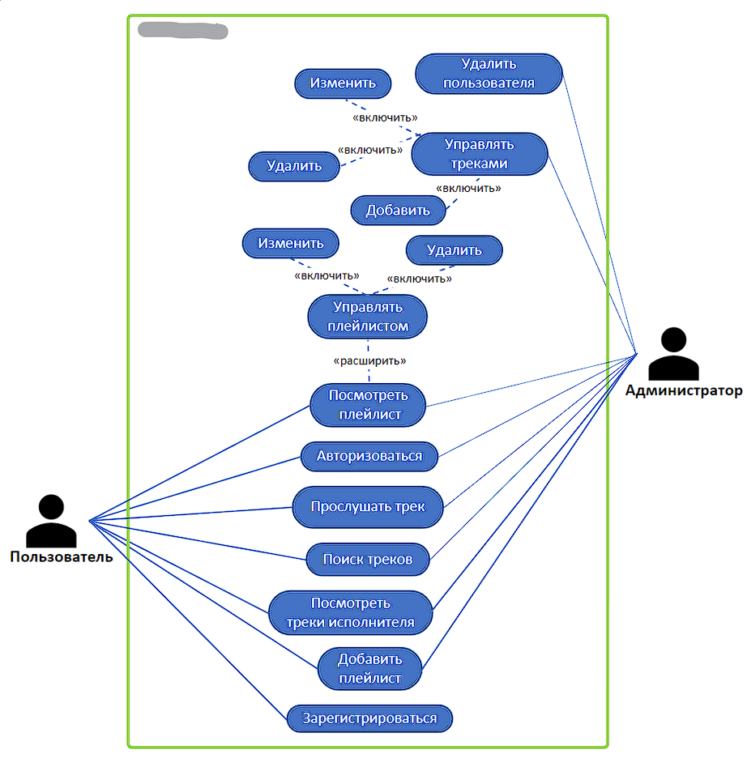
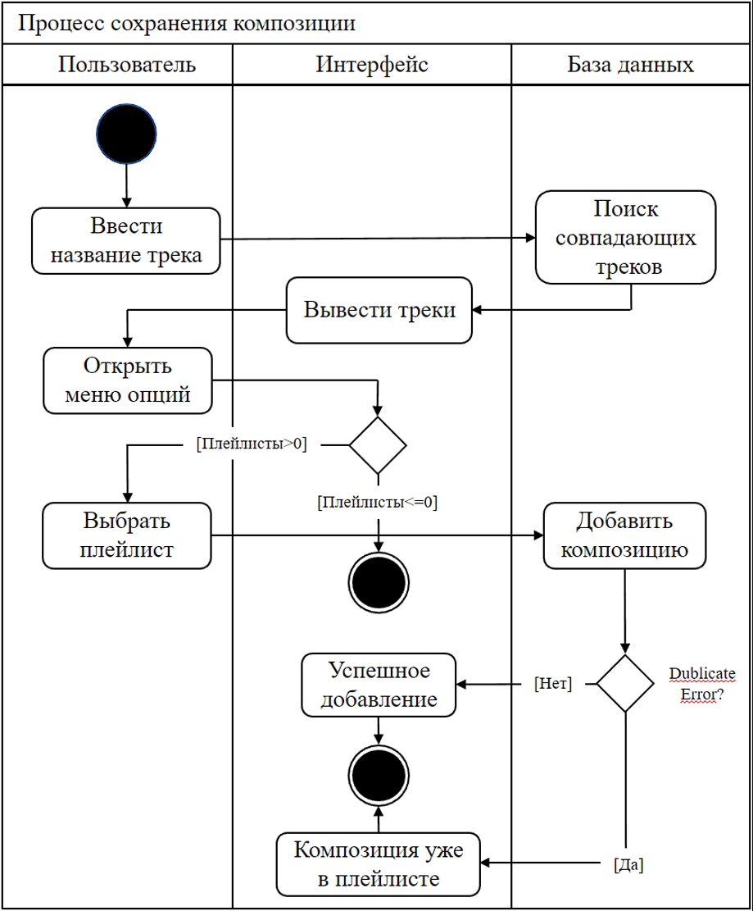
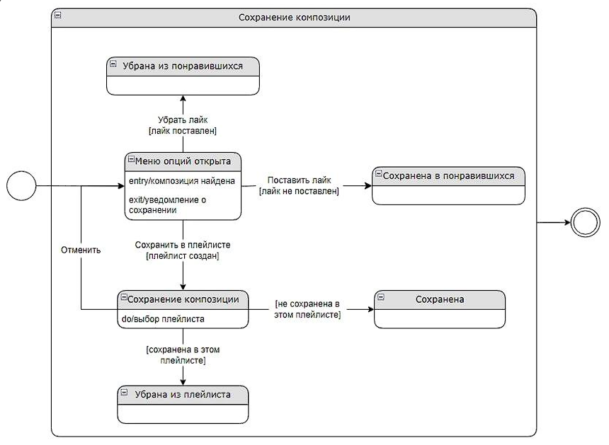
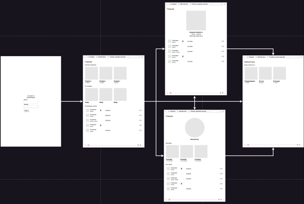
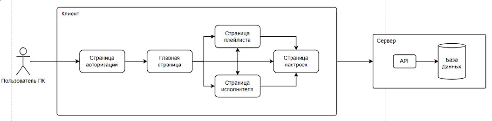

# UwpMusicClient
Music Streaming Service (UWP)
Нативный клиент потокового музыкального сервиса для платформы Windows (UWP), построенный на клиент-серверной архитектуре.
Реализованы авторизация пользователей, профили, плейлисты, библиотека композиций, рекомендации и подборки контента на основе клиент-серверной архитектуры.

*Период разработки: январь 2023 — март 2023 (архивный R&D / учебный проект).*

**Стек:** `C#` • `UWP` • `.NET Framework` • `Клиент/сервер` • `UML`

📖 **[Руководство пользователя](https://bkhaev.gitbook.io/uwpmusicclient/)**

_Оригинальное название проекта, брендинг и графические ассеты были заменены на абстрактные перед публикацией в портфолио._

## Архитектура и ключевые решения
* **Интеграция с экосистемой (Backend & SSO):** серверная часть, база данных и хранение медиаконтента вынесены во внешний проект ([CreatorAssetHub](https://github.com/bkhaev/CreatorAssetHub)). Приложение использует единую учётную запись экосистемы.
* **Авторизация и управление сессиями:** при запуске клиент выполняет автоматическую проверку и восстановление активной сессии на сервере; при её отсутствии экран ожидает ввод учётных данных. Явное завершение сессии реализовано через настройки профиля.
* **Архитектура тонкого клиента (Streaming):** аудиопотоки, графические обложки и персональные рекомендации формируются и хранятся на сервере без локального скачивания медиафайлов на диск во время проигрывания.
* **Единая абстракция коллекций (DRY):** пользовательские плейлисты, системные списки реакций (автоматически генерируемые при отметках «Нравится» / «Не нравится»), альбомы, жанры и редакционные подборки унифицированы на уровне API и клиента в единую абстрактную модель, отображаемую через один переиспользуемый экран.
* **Нативный UX платформы Windows:** реализована адаптивная вёрстка под различные разрешения экранов и поддержка системной навигации (обработка аппаратных кнопок «Назад» и «Вперёд» на клавиатурах, мышах и планшетах).

Композиции с нецензурной лексикой отмечены значком `E`.

После завершения проигрывания композиции начинает проигрываться следующая из активного списка.

## Сборка и распространение (Sideloading)
Так как проект не публичный, а учебный, он не публиковался в Microsoft Store и рассчитан на прямое распространение (Sideloading) в формате **MSIX-пакета**, подписанного тестовым сертификатом сроком на 1 год.

### Особенности локального запуска
* Базовый адрес API задан в конфигурации (`localhost`).
* Поскольку серверная часть и БД находятся в отдельном репозитории, при локальной сборке без развёрнутого бэкенда приложение запустится до экрана авторизации.

## Мокапы
Все мокапы расположены в `docs/mockup`.

## UML

### Use Case

### Activity

## State Machine

## Flow Chart

## System Architecture

